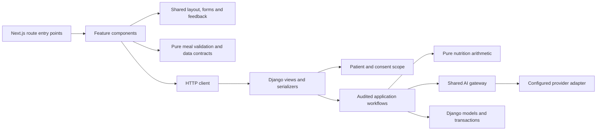

# Architecture and code ownership

Kulya is a modular Django/Next.js application. Business calculations, patient workflows,
transport and presentation have distinct owners. This cleanup applies Clean Architecture's
dependency direction to the existing frameworks; it does not claim that every Django
workflow is framework independent.

## Dependency direction

| Owner | Purpose |
| --- | --- |
| `frontend/src/app` | Route entry points and role-specific page composition. |
| `frontend/src/features` | Clinical, notification and nutrition UI and their feature rules. |
| `frontend/src/components` | Reusable layout, feedback, forms and UI primitives. No feature UI imports. |
| `frontend/src/lib/api.ts` | Requests, tab-scoped credentials, refresh and API errors. |
| `frontend/src/lib/types.ts`, feature `types.ts` | API data contracts without React or request logic. |
| `frontend/src/lib/validation.ts` | Shared form validation. |
| `frontend/src/features/nutrition/meal-input.ts` | Pure portion parsing and confirmed-meal validation; clock and catalogue are supplied by the caller. |
| `backend/*/views.py`, serializers | HTTP adaptation, endpoint role policy and input validation. |
| `backend/core/permissions.py`, `nutrition/access.py` | Reachable records, assignment and current consent. Scope is applied before serialization or writing. |
| `backend/*/services.py` | Audited use cases, transactional changes and workflow state. |
| `backend/nutrition/engine.py` | Pure nutrient arithmetic. No database, framework, provider or clock. |
| `backend/nutrition/catalog.py` | Catalogue loading and bilingual matching; no patient workflow. |
| `backend/assistant/ai.py` | The record assistant's prompt id, output schema, validation and rule-based answers. Pure: no database, framework or clock. |
| `backend/assistant/services.py` | Collects what the patient may already see, asks the model, checks and stores the answer. |
| `backend/ai/gateway.py`, provider | One provider-call boundary, including recorded failure handling. |
| `backend/ai/output_validation.py` | Public schema and grounding primitives shared by clinical and nutrition validation. |

## Decisions and reasons

- Split the previous `components/app.tsx` and `components/nutrition.tsx` by responsibility.
  Callers import each owner directly; compatibility barrels would hide the new boundaries.
- Separate API contracts from HTTP transport so rendering and pure rules do not import
  credential handling just to describe data.
- Nutrition no longer imports a private clinical AI service function or private validation
  helpers. Both workflows use the public shared gateway and output-validation module.
- Keep Django transactions and model access in application workflows. A repository wrapper
  with the same methods would add indirection without a second persistence adapter or a
  demonstrated need. Framework-independent numerical rules already have their own module.
- Preserve server authorization, audit trails, soft withdrawal, clinician review, database
  migrations and API routes. Browser visibility never grants access to a record.
- Keep useful UI primitives and remove unused badge/select implementations, five starter
  SVGs, four unused card/table exports, generator configuration and its unused utility alias. Remove `shadcn` and
  `tw-animate-css`; the used tab selectors now use native Tailwind attribute variants, and
  loading animation uses Tailwind's built-in `animate-pulse`.
- Use Prettier for readable, consistent TypeScript; lint rejects unused bindings and requires
  explicit type imports. Match Node types to the project's Node 24 runtime instead of
  bypassing Vitest's peer requirements.
- CI and container images also use Node 24, and install from the lockfile without the old
  peer-dependency bypass. The container no longer copies a starter asset directory that has
  no tracked files.

## Second pass: the code added after the first cleanup

Checked with Ruff's unused-code and complexity rules, Vulture, and Knip, then fixed by hand.

- Account creation, deactivation, password change and patient registration were written inside
  views. They are audited use cases, so they moved to `core/services.py` and
  `clinical/services.py`; their input checks moved into the serializers. The views now only
  adapt HTTP, like the rest of the codebase.
- `assistant/chat.py` mixed four jobs. It is now `assistant/ai.py` (wording and validation,
  pure) and `assistant/services.py` (workflow), the same split nutrition already uses.
- `nutrition.services.suggest` had grown past ten branches. Ordering by laboratory results and
  asking the model for wording are now two named helpers, and the string test that filtered
  reasons by their text is replaced by an explicit argument.
- The analyte-to-nutrient table existed twice; the food-and-lab review now derives it from the
  one in `nutrition/engine.py`.
- Deleted because nothing used them: `consent_scopes`, `AUDIT_FIELDS`, six `noqa` markers for
  rules that are not enabled (their reasons stay as plain comments), and seven exports that are
  only used inside their own file.
- Ruff now also enforces a branch limit per function (`C90`) and rejects suppressions that
  suppress nothing (`RUF100`).

Left alone on purpose: unused `request`, `pk`, `args` and `kwargs` parameters are signatures
required by Django and DRF, and choice values such as `ActionType.MEDICATION` are data, not
dead code.

## Guardrails

Frontend architecture tests reject runtime source import cycles, shared-to-feature-UI
dependencies, imports of route entry points and React/HTTP dependencies in pure contracts
and meal rules. Backend architecture tests protect the pure arithmetic module, the shared
provider boundary and the assistant's pure wording module. Behavioral suites cover the clinical and nutrition workflows.

Run frontend `typecheck`, `lint`, `format:check`, `test`, and the isolated-database browser
suite. Run backend Ruff and pytest. The root test report records results.

Dependency audit at cleanup: zero production advisories; five high-severity development
advisories remain in the Next ESLint/fast-glob/micromatch/braces chain. The reported fix
requires a framework downgrade, so no forced downgrade was applied. This is an outstanding
toolchain issue, not a claim that all dependencies are vulnerability-free.

## Sources used

- [Robert C. Martin: Clean Architecture](https://blog.cleancoder.com/uncle-bob/2012/08/13/the-clean-architecture.html): dependencies point toward policy; outer details should not control inner rules.
- [Django design philosophies](https://docs.djangoproject.com/en/5.2/misc/design-philosophies/): loose coupling, cohesion and avoiding repeated knowledge.
- [Next.js project structure](https://nextjs.org/docs/app/getting-started/project-structure): organization and colocation outside public route entry points.
- [Next.js server/client components](https://nextjs.org/docs/app/getting-started/server-and-client-components): interactive and browser behavior belongs behind explicit client boundaries.
- [HackSoft Django Styleguide](https://github.com/HackSoftware/Django-Styleguide): business logic in services, not in views or serializers; adopted as far as it fits.
- [bulletproof-react](https://github.com/alan2207/bulletproof-react): shared code is imported by features, features by routes, never the other way.
- [Martin Fowler: Refactoring](https://www.martinfowler.com/books/refactoring.html): design changes should preserve observable behavior and be verified incrementally.

These sources guide the decisions above; they do not prescribe this exact folder tree.
