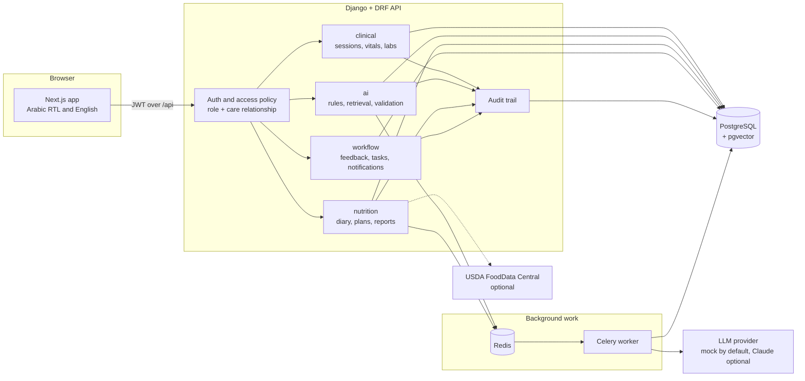
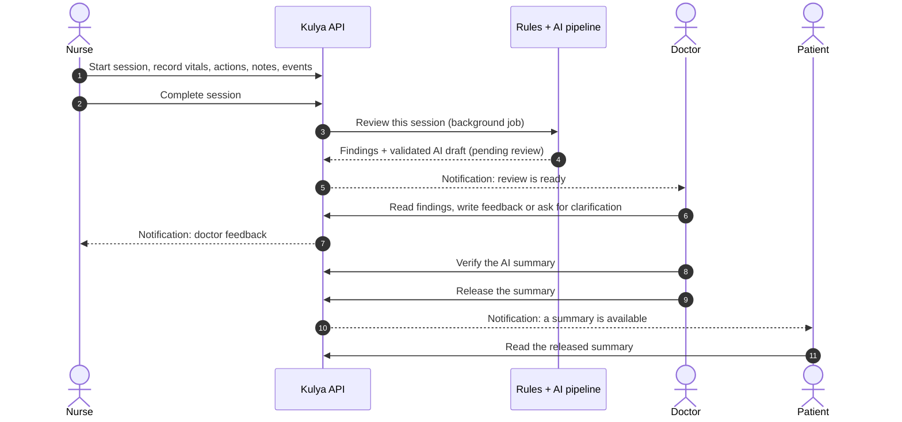
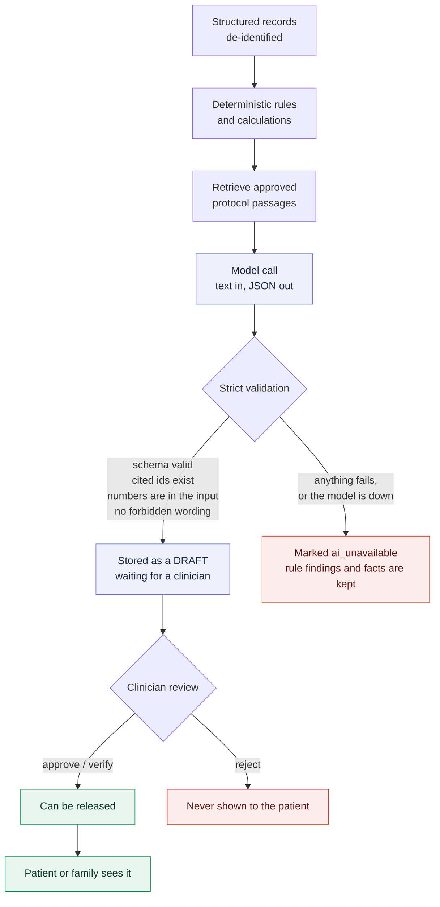
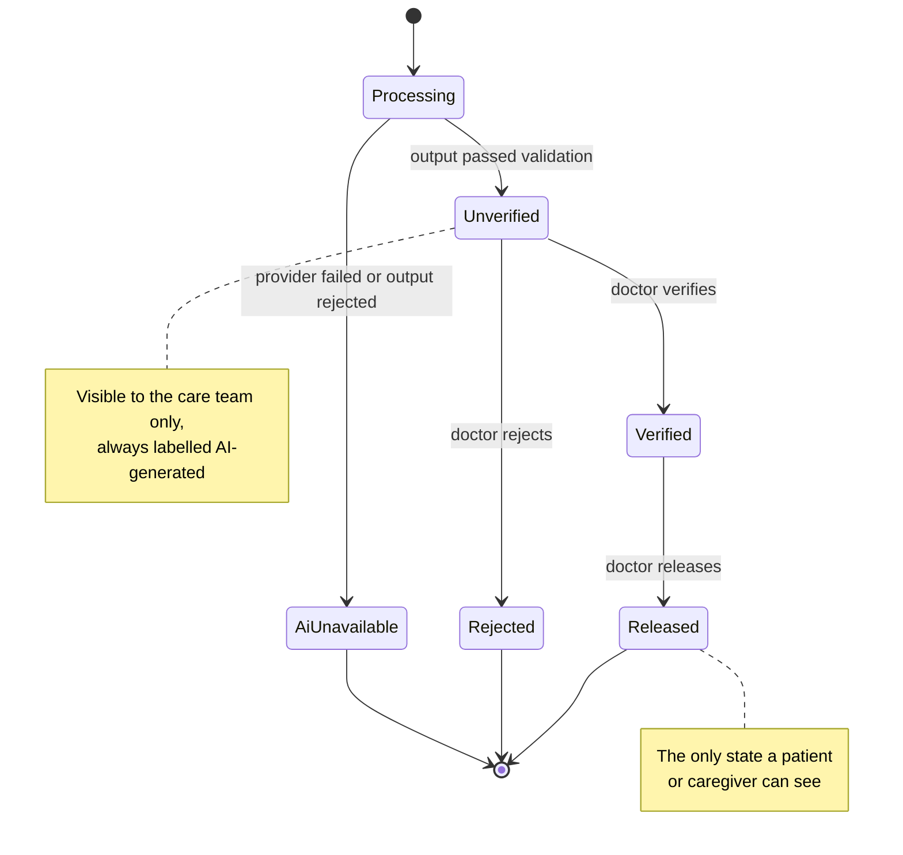
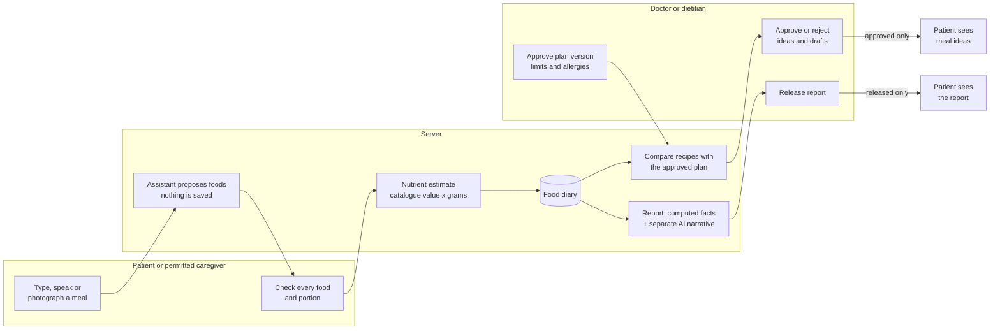
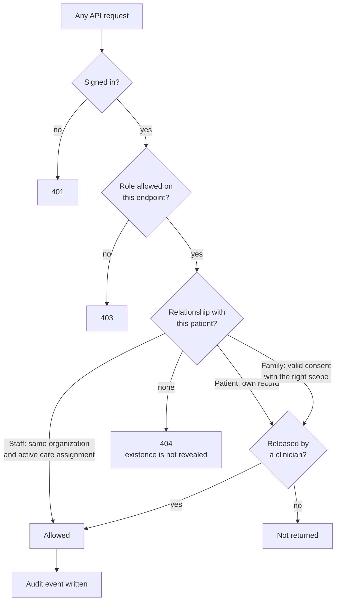

<div align="center">

# Kulya · كُلية

**A dialysis care companion: session documentation, AI-assisted review, and renal nutrition —<br>
with a human clinician between every AI draft and every patient.**


</div>

> [!WARNING]
> **Functional hackathon demo on synthetic data. Not a medical device. Not validated for real
> patients.** See [`TEST_REPORT.md`](TEST_REPORT.md) for what was actually tested, and
> [`SECURITY.md`](SECURITY.md) / [`DEPLOYMENT.md`](DEPLOYMENT.md) for what real use would still require.

## Contents

- [The idea in one minute](#the-idea-in-one-minute)
- [Who uses it](#who-uses-it)
- [What it does](#what-it-does)
- [How it works](#how-it-works)
  - [System architecture](#system-architecture)
  - [A dialysis session, end to end](#a-dialysis-session-end-to-end)
  - [The AI safety pipeline](#the-ai-safety-pipeline)
  - [Life of an AI draft](#life-of-an-ai-draft)
  - [Renal nutrition](#renal-nutrition)
  - [Who can see what](#who-can-see-what)
- [Quick start (Docker)](#quick-start-docker)
- [Demo accounts](#demo-accounts)
- [Local development](#local-development)
- [Tests](#tests)
- [Where things are](#where-things-are)
- [Tech stack](#tech-stack)
- [Known limits](#known-limits)
- [More documentation](#more-documentation)

## The idea in one minute

A patient on haemodialysis is treated three times a week, for years. Every session produces
measurements, nursing actions, notes and events, and between sessions the patient has to manage
a demanding diet largely alone.

| The problem | What Kulya does |
|---|---|
| Session documentation has gaps that are found late, or never. | Fixed rules check each session; an AI draft explains the gaps and cites the records and protocol passages it used. |
| Doctors read raw charts to understand one session. | An AI summary draft is prepared; the doctor verifies it. |
| Patients and families rarely get a plain explanation. | The patient sees a summary **only after** a doctor verifies and releases it. |
| Diet is hard to follow and hard for clinicians to see. | A food diary (type, speak or photograph a meal), a clinician-approved plan, rule-based meal ideas and periodic reports. |

Three rules shape everything else:

1. **AI drafts, humans decide.** Nothing written by a model reaches the record or a patient without a clinician's review.
2. **Numbers come from code, not from the model.** Durations, nutrient totals and limits are calculated by deterministic code. A missing value stays "not available" and is never shown as zero.
3. **Deny by default.** Every request is checked for role *and* for a care relationship with that specific patient.

## Who uses it

| Role | What they do in Kulya |
|---|---|
| **Nurse** | Runs today's sessions: vitals, machine readings, actions, notes, events. Records eating concerns and can refer them. |
| **Doctor** | Reviews documentation findings and AI drafts, gives feedback, verifies and releases summaries, writes dialysis orders, approves nutrition plans. |
| **Renal dietitian** | Approves nutrition plans, reviews meal ideas and food-and-lab drafts, releases nutrition reports. |
| **Patient** | Sees released summaries, released lab results and appointments; keeps a food diary; decides what family may see. |
| **Family caregiver** | Sees only what the patient has shared, and only while that consent is valid. |

## What it does

Kulya has two halves: documenting and reviewing dialysis sessions, and managing renal nutrition.
In both, AI only writes drafts and a clinician approves anything before a patient sees it.

### Dialysis sessions

| Feature | What happens |
|---|---|
| **Session documentation** | A nurse schedules, starts and completes a session, and records vitals, machine readings, nursing actions, notes and events such as low blood pressure or cramps. Signed records cannot be overwritten, only amended with a new record. |
| **Completeness checks** | Fixed rules flag gaps: a missing post-treatment weight, an action with no reason, an unresolved event, a session shorter than prescribed. |
| **AI documentation review** | After a session is completed, a draft explains the gaps and cites the records and protocol passages it used. It goes to the assigned doctor. |
| **AI session summary** | A draft with a clinician version and a plain-language patient version. The doctor verifies or rejects it, then chooses whether to release it. |
| **Doctor feedback** | The doctor writes feedback or a clarification request; the nurses on that patient are notified. |
| **Orders and labs** | The doctor writes versioned dialysis orders, sees lab trends, and releases lab reports to the patient one at a time. |

### Renal nutrition

| Feature | What happens |
|---|---|
| **Food diary** | The patient types, speaks or photographs a meal; the assistant proposes foods and the patient confirms each line before saving. |
| **Nutrient estimates** | The server calculates energy, protein, sodium, potassium, phosphorus, calcium and fluid from the food catalogue. Unknown values stay "not available", never zero. |
| **Nutrition plan** | A doctor or dietitian approves per-meal limits and allergies; each change is a new version. |
| **Meal ideas** | Recipes are compared with the approved plan by fixed rules; a clinician approves personalized ones before the patient sees them. |
| **Food and lab view** | The diary and lab results side by side, with a descriptive AI draft that never claims a food caused a result. |
| **Nutrition reports** | Computed facts plus an AI narrative, released by a clinician and printable to PDF. |
| **Nurse observations** | Appetite or nausea concerns, which can be referred to the doctor and dietitian. |

### Across the whole app

- **Five roles** — nurse, doctor, renal dietitian, patient and family caregiver — each with its own dashboard.
- **Access control** — staff see only patients on their care team; patients see only their own released information.
- **Family sharing** — the patient chooses what a caregiver can see (summaries, appointments, labs, food diary, logging meals for them) and can revoke it.
- **Notifications and audit trail** — each user has an inbox, and every write and sensitive read is logged.
- **Arabic right-to-left interface** by default, with an English switch.

## How it works

### System architecture



Only the worker path ever talks to a model, and the model has no tools and no part in
authorization. With `LLM_PROVIDER=mock` (the default) nothing leaves the machine.

### A dialysis session, end to end



Signed records (vitals, readings, actions, notes) are never overwritten: a correction is a new
record that points at the original.

### The AI safety pipeline

Every AI feature — documentation review, session summary, meal recognition, food-and-lab review,
meal-idea wording, nutrition report — goes through the same gate.



What validation rejects: output that does not match the schema, citations of records that were
not provided, numbers that are not values in the input, diagnosis or prescribing language,
causal claims between food and lab results, and medication advice. The wording filter is a
keyword list — a blunt net; the reviewing clinician is the real control.

### Life of an AI draft



### Renal nutrition



- The assistant only **proposes** foods; a meal is saved after the person confirms each line.
- Nutrient numbers are calculated by the server. A food that is not in the catalogue has
  **unknown** values, and a day with no record is "not recorded" — never "ate nothing".
- Limits exist only in a plan a clinician approved. Without one, meal ideas are labelled general.
- Food and lab results are shown **side by side**. The app never claims a food changed a result.
- The bundled food catalogue (`backend/nutrition/data/catalog.json`) is **approximate and
  unverified**. `python manage.py load_food_catalog` loads it; `seed_demo` does this for you.
- Optional: set `USDA_API_KEY` to let a doctor or dietitian import foods from USDA FoodData
  Central (`/api/nutrition/foods/?q=...&source=usda`).

### Who can see what



| | Session records | AI drafts | Released summaries | Lab results | Food diary | Approve plans / release |
|---|:-:|:-:|:-:|:-:|:-:|:-:|
| Nurse (assigned) | read + write | read | read | read | read | — |
| Doctor (assigned) | read | review | verify + release | read + release | read | yes |
| Dietitian (assigned) | — | nutrition only | — | read | read | nutrition only |
| Patient | — | — | own | own, released | own, write | — |
| Family (consent) | — | — | if shared | if shared, released | if shared | — |

Family sharing is per patient and per scope (`summaries`, `appointments`, `labs`, `nutrition`,
`nutrition_log`), can expire, and can be revoked by the patient at any time.

## Quick start (Docker)

```bash
cp .env.example .env        # then set DEMO_PASSWORD (and DJANGO_SECRET_KEY)
docker compose up --build
```

Open http://localhost:3000 and sign in with a demo account and your `DEMO_PASSWORD`.

The interface is Arabic and right-to-left by default; the **الإنجليزية** button in the header (and on
the sign-in page) switches language. Record content and AI drafts are shown as stored.

## Demo accounts

All people and records are invented. Every account uses the `DEMO_PASSWORD` you set in `.env`.

| Account | Role | Sees |
|---|---|---|
| `doctor1` | doctor | SYN-001, SYN-002 |
| `doctor2` | doctor | SYN-003 |
| `nurse1`–`nurse3` | nurse | SYN-001, SYN-002 |
| `nurse4`–`nurse6` | nurse | SYN-003 |
| `dietitian1` | renal dietitian | nutrition for SYN-001, SYN-002, SYN-003 |
| `patient1`–`patient3` | patient | own released records and own food diary |
| `family1` | family caregiver | SYN-001: summaries, appointments and nutrition (consent) |
| `family2` | family caregiver | nothing (consent expired) |
| `auditor1`, `orgadmin1` | audit / admin | no clinical data |

A five-minute tour: sign in as `nurse1` and complete a session → `doctor1` reviews the draft,
verifies and releases the summary → `patient1` reads it and adds a meal → `dietitian1` approves a
meal idea and releases the nutrition report.

## Local development

```bash
docker compose up -d db redis                       # Postgres + pgvector on :5433, Redis on :6380
cd backend
python -m venv .venv && .venv/Scripts/pip install -r requirements.txt   # bin/ on Linux/macOS
.venv/Scripts/python manage.py migrate
.venv/Scripts/python manage.py seed_demo            # needs DEMO_PASSWORD in ../.env
.venv/Scripts/python manage.py runserver 8000
cd ../frontend && npm ci --legacy-peer-deps && npm run dev      # http://localhost:3000
```

AI jobs run inline by default (`CELERY_TASK_ALWAYS_EAGER=true`). With Docker Compose they run in
a real Celery worker. The default `LLM_PROVIDER=mock` needs no key; set `LLM_PROVIDER=anthropic`
and `ANTHROPIC_API_KEY` to use Claude.

| Setting | Default | Purpose |
|---|---|---|
| `DEMO_PASSWORD` | — (required) | Password for every seeded demo account |
| `LLM_PROVIDER` | `mock` | `mock` runs offline; `anthropic` calls Claude |
| `ANTHROPIC_API_KEY` | empty | Needed only with `LLM_PROVIDER=anthropic` |
| `USDA_API_KEY` | empty | Enables the optional USDA food lookup |
| `CELERY_TASK_ALWAYS_EAGER` | `true` locally | `false` sends AI jobs to the worker |

The full list is in [`.env.example`](.env.example).

## Tests

```bash
cd backend  && .venv/Scripts/python -m pytest          # needs the db container
cd frontend && npm test                                # unit, component and architecture tests
cd frontend && npx playwright install chromium && npm run e2e   # needs the isolated test stack
cd frontend && npm run typecheck && npm run lint && npm run format:check
```

The E2E run adds synthetic sessions, measurements, diary entries, nutrition plan versions and
report releases. Sign-in is limited to 10 per minute. For the complete suite, use the separate
local test database and servers documented in `NUTRITION_WORKFLOW.md`. The cases now create
their own workflow records and tolerate earlier runs; no database flush is required.

All tests run offline against the mock provider; none needs an API key.

## Where things are

```text
Kulya/
├── backend/                  Django + DRF API
│   ├── core/                 users, roles, access policy, audit, error format
│   ├── clinical/             patients, care teams, consent, sessions, vitals, labs
│   ├── ai/                   rules, retrieval, provider adapters, validation, prompts
│   ├── workflow/             doctor feedback, review tasks, notifications
│   ├── nutrition/            food catalogue, diary, plans, suggestions, reports
│   └── tests/                pytest suite (security, AI, workflow, nutrition)
├── frontend/                 Next.js + TypeScript + Tailwind + Base UI primitives
│   ├── src/app/              doctor, nurse, patient, dietitian screens
│   ├── src/components/       shared shell, feedback, forms and UI primitives
│   ├── src/features/         clinical records, notifications and nutrition workflows
│   ├── src/lib/              transport, contracts, authentication and localization
│   └── e2e/                  Playwright browser tests
├── docs/openapi.yaml         generated API schema (live at /api/docs/ on the backend)
└── docker-compose.yml        db, redis, backend, worker, frontend
```

## Tech stack

| Layer | Choice |
|---|---|
| API | Django 5, Django REST Framework, simplejwt, drf-spectacular |
| Data | PostgreSQL 16 with pgvector |
| Background jobs | Celery + Redis |
| AI | Provider abstraction: offline mock (default) or Anthropic Claude; JSON Schema validation |
| Web | Next.js (App Router), TypeScript, Tailwind CSS, Base UI, Recharts, React Hook Form + Zod |
| Tests | pytest, Vitest + Testing Library, Playwright |
| Delivery | Docker Compose, GitHub Actions workflow |

## Known limits

Stated plainly, because this is health software:

- **No real model has been evaluated.** The AI features were built and tested against the offline
  mock provider. Output quality with a real model is unknown.
- **The food catalogue is unverified** and small. Nutrient values are approximate.
- **Protocol text is synthetic.** No clinician has approved the rules, prompts or wording.
- **Retrieval uses a simple lexical embedding**, not a semantic model.
- **Voice entry uses the browser's speech service**; there is no server-side transcription.
- **Session tokens live in browser session storage**; there is no MFA or password reset.
- **Arabic wording has not been reviewed by a clinician or medical translator.**
- Software tests cannot make this clinically safe. Real use needs clinical assessment, a privacy
  review and any regulatory clearance that applies.

## More documentation

| Document | What is in it |
|---|---|
| [`ARCHITECTURE.md`](ARCHITECTURE.md) | Apps, data rules, authorization, the AI features in detail |
| [`CODE_STRUCTURE.md`](CODE_STRUCTURE.md) | Code ownership, dependency rules, cleanup decisions and research sources |
| [`SECURITY.md`](SECURITY.md) | What is enforced and tested, known gaps, what real use requires |
| [`DEPLOYMENT.md`](DEPLOYMENT.md) | Running the stack and what production would still need |
| [`TEST_REPORT.md`](TEST_REPORT.md) | What was run, the results, and what was not tested |
| [`TASKS.md`](TASKS.md) | Task list with status, evidence and limitations |
| [`docs/openapi.yaml`](docs/openapi.yaml) | Full API schema |
| [`Dialysis-Copilot-3min.pdf`](Dialysis-Copilot-3min.pdf) | The 3-minute pitch deck |

---

<div align="center">
<sub>Kulya is a demonstration built on synthetic data. It does not diagnose, prescribe, or replace clinical judgement.</sub>
</div>
